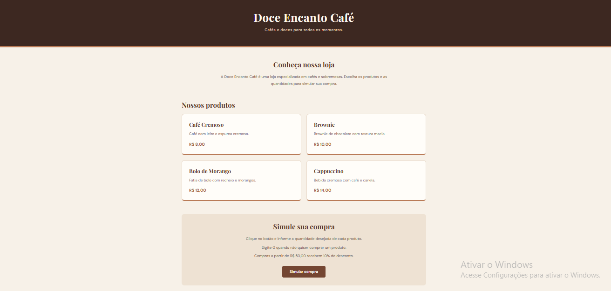

# Doce Encanto Café

## Informações do projeto

- **Projeto:** Doce Encanto Café — Simulador de Compras
- **Aluna:** MILAINY SANTOS COSTA
- **Trilha:** TRILHA 2026 - DESENVOLVIMENTO MOBILE

## Apresentação da loja

A Doce Encanto Café é uma loja fictícia especializada em cafés e sobremesas. O projeto permite que o cliente escolha a quantidade de cada produto e simule o valor de sua compra.

## Produtos e preços

| Produto | Descrição | Preço |
|---|---|---:|
| Café Cremoso | Café com leite e espuma cremosa | R$ 8,00 |
| Brownie | Brownie de chocolate com textura macia | R$ 10,00 |
| Bolo de Morango | Fatia de bolo com recheio e morangos | R$ 12,00 |
| Cappuccino | Bebida cremosa com café e canela | R$ 14,00 |

A loja oferece 10% de desconto para compras a partir de R$ 50,00.

## Tecnologias utilizadas

- HTML: estrutura da página.
- CSS: aparência e organização dos elementos.
- JavaScript: perguntas, cálculos e resultado da simulação.

## Como executar o projeto

1. Baixe ou clone este repositório.
2. Abra a pasta do projeto no Visual Studio Code.
3. Abra o arquivo `index.html` no navegador.
4. Clique no botão "Simular compra".
5. Informe a quantidade desejada de cada produto.
6. Digite 0 quando não quiser comprar determinado produto.

## Captura de tela

## Testes realizados

Foram realizados os seguintes testes:

- **Teste 1:** compra de uma unidade de cada produto. Resultado: subtotal de R$ 44,00, sem desconto.
- **Teste 2:** compra de duas unidades de Café Cremoso, duas de Brownie, uma de Bolo de Morango e uma de Cappuccino. Resultado: subtotal de R$ 62,00, desconto de R$ 6,20 e total de R$ 55,80.
- **Teste 3:** quantidade zero para todos os produtos. Resultado: mensagem informando que nenhum produto foi selecionado.

## Dificuldade encontrada e aprendizado

Uma das dificuldades foi organizar os códigos nos arquivos corretos e entender como abrir a página HTML no navegador.

Durante o desenvolvimento, aprendi a trabalhar com variáveis, tipos de dados, operadores, condicionais, estruturas de repetição, arrays, objetos e funções em JavaScript. Também pratiquei a integração entre HTML, CSS e JavaScript.

## Uso de inteligência artificial

A inteligência artificial foi utilizada como apoio durante o desenvolvimento, principalmente para explicar os códigos, ajudar na organização dos arquivos e sugerir correções.

